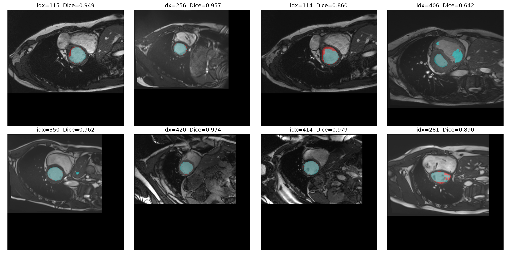
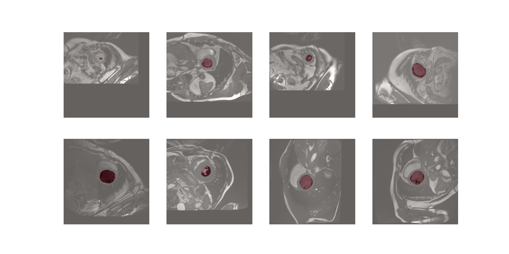

# M4: ACDC 心脏磁共振左心室分割（PyTorch 入门实战）

用 2D U-Net（TinyUnet）对 ACDC 心脏 MRI 数据集进行左心室（LV）自动分割，
从零打通「数据探索 → Dataset 构建 → 可视化 → 训练 → 推理」完整深度学习管线。

> **最终结果：best val Dice = 0.8275**（100 epochs，RTX 3060 Laptop，约 1h38m）

## 项目背景

深度学习自学路线第 10 周（M4）动手任务：在 M3 驾驶场景分割的基础上，
迁移到医学影像场景，独立完成一个医学图像分割任务的全流程。

## 数据集

[ACDC（Automated Cardiac Diagnosis Challenge）](https://www.creatis.insa-lyon.fr/Challenge/acdc/)

- 100 名患者 cine-MRI，`patientXXX_frameYY.nii.gz` + 对应 `_gt` 标注
- 标签：0 背景 / 1 右心室 RV / 2 心肌 MYO / 3 左心室 LV
- 本项目做**二分类**：`mask = (gt == 3)`，只分割左心室
- 每个 3D volume 按层切成 2D 切片，共 **1442 张**（前 80 病人训练 / 后 20 病人验证，验证集 460 张）
- 各病人尺寸不一，统一 `F.pad` 到 256×256

## 模型

**TinyUnet**（轻量版 U-Net，`in_ch=1` 灰度输入），损失函数为
**Dice Loss**（纯 Dice，直接优化前景重叠度，对抗前景占比小的类别不均衡问题）。

## 目录结构

```
M4_ACDC/
├── explore_acdc.py     # 数据探索：病人数量、尺寸、标签分布
├── acdc_dataset.py     # ACDCDataset：切片读取、二值化、归一化、pad
├── visualize.py        # 8 张 image/mask 叠加可视化（ground truth）
├── train_acdc.py       # 训练主脚本：训练循环 + 验证 + 保存最优权重
├── inference.py        # 推理可视化：加载权重，预测并排对比 图/真值/预测
├── save_weights/
│   └── best_acdc.pth   # 训练好的权重（未上传，见 .gitignore）
├── train_acdc_log.txt  # 训练日志
├── acdc_vis.png        # 标注可视化
└── inference_vis.png   # 推理对比图
```

## 环境与运行

```bash
# Python 3.12 + PyTorch (CUDA 11.8)
pip install torch torchvision nibabel matplotlib --index-url https://download.pytorch.org/whl/cu118

# 1. 数据探索
python explore_acdc.py

# 2. 可视化标注
python visualize.py

# 3. 训练（-u 关闭缓冲，实时打印每个 epoch）
python -u train_acdc.py --epochs 100 2>&1 | Tee-Object train_acdc_log.txt

# 4. 推理可视化（用训练好的权重在验证集上预测并画图）
python -u inference.py
```

## 结果

| 指标 | 数值 |
|---|---|
| best val Dice | **0.8275** |
| 最终 val Dice | 0.8176 |
| 目标 | 0.70 ✅ 超额完成 |
| 训练时长 | 1h38m / 100 epochs（RTX 3060 Laptop 6GB） |
| 显存占用 | ~3.7 GB |

## 第 11 周：调参实验（消融）

在基准 0.8275 基础上做「一次只改一个变量」的对比实验，完整台账见
[EXPERIMENTS.md](EXPERIMENTS.md)：

| 实验 | 改动 | best val Dice |
|---|---|---|
| 基准（纯 Dice） | — | 0.8275 |
| +Cosine 调度 | CosineAnnealingLR | 0.8460 |
| +数据增强 | 翻转/旋转/亮度 | 0.8594 |
| 100→200 ep | 训练时长翻倍 | ~0.8550 |
| 纯 BCE | 损失换成 BCEWithLogitsLoss | **0.8680** ⭐ |

结论：最优 = 纯 BCE + cosine（0.8680）。最有价值的发现是推翻了「纯 BCE 必退化」的预设，
完整归因见 EXPERIMENTS.md。

## 可视化

标注叠加（红/橙 = ground truth，绿 = 模型预测，重叠 = 黄色为正确分割）：





## 踩坑记录

1. **Dataset 忘存 flag**：`__init__` 里必须 `self.train_flag = train`，否则增强逻辑报 `AttributeError`
2. **翻转增强要同步**：img 和 mask 必须同时翻转，且用 `.copy()` 防止数组视图问题
3. **尺寸不一致**：不同病人 slice 尺寸不同，需 `F.pad` 到统一 256×256
4. **管道输出缓冲**：`| Tee-Object` 会触发 Python 输出缓冲，加 `-u` 才能实时看到每个 epoch 的日志
5. **mask 全 0 不是 bug**：不含 LV 的切片（如心脏边缘层）mask 本来就为空，属正常
6. **推理加载权重两步走**：先 `TinyUnet()` 建空网络，再 `load_state_dict(torch.load(...))` 灌参数；
   不能把 `torch.load` 的返回值（参数字典 OrderedDict）直接当模型用
7. **结构只留一份**：网络结构、Dataset 定义只写一份供各脚本 import，复制一份改必导致
   `size mismatch`（加载时参数名/形状对不上）
8. **兼容字典输出**：部分网络 forward 返回 OrderedDict，推理时先判断 `isinstance(out, dict)`
   再取 `out["out"]`

## 学到什么

- 医学影像（NIfTI 格式）的读取与 3D→2D 切片处理
- 损失函数的消融对比：纯 Dice vs 纯 BCE 在具体任务上的真实表现，破除「纯 BCE 必退化」的教条
- Dataset / DataLoader 规范写法与数据增强的"同变"原则
- 训练脚本的工程化：日志、最优权重保存、训练/验证分离
- 推理阶段的标准流程：`model.eval()` + `torch.no_grad()` + 权重加载 + 结果后处理（sigmoid → 0.5 阈值 → 二值 mask）
